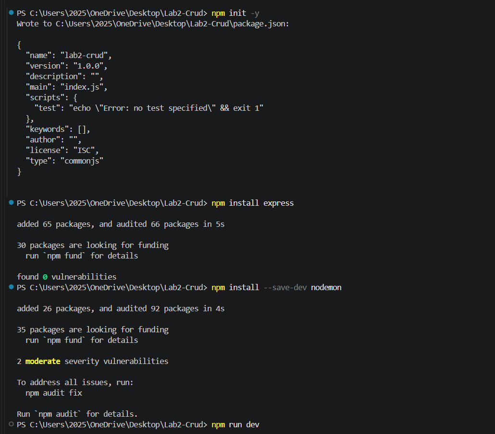
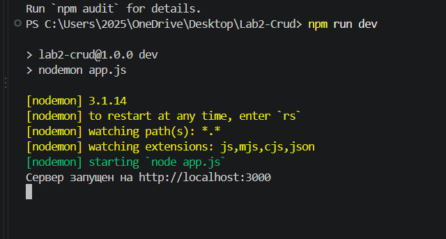
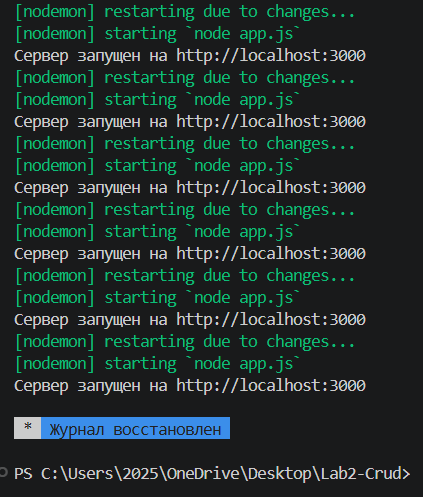
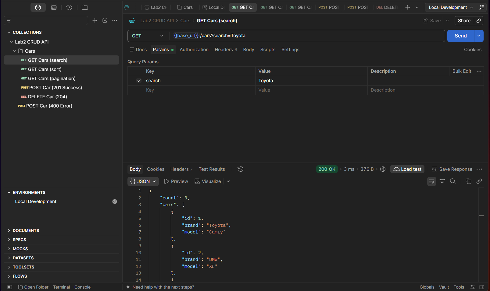
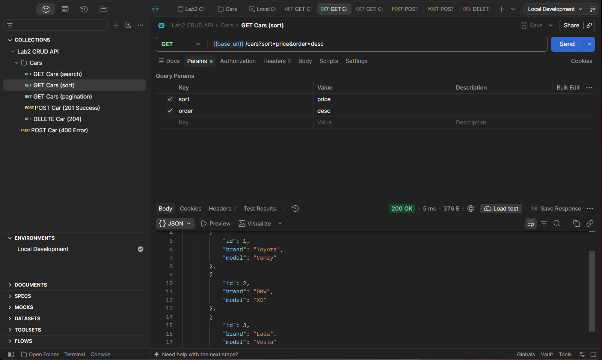
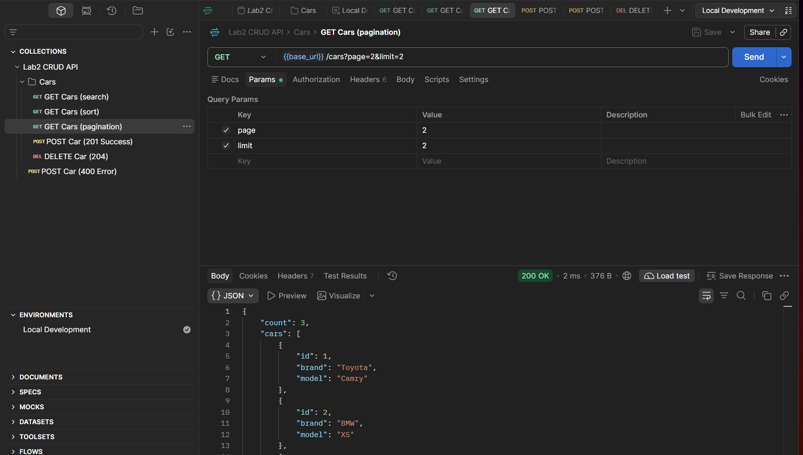
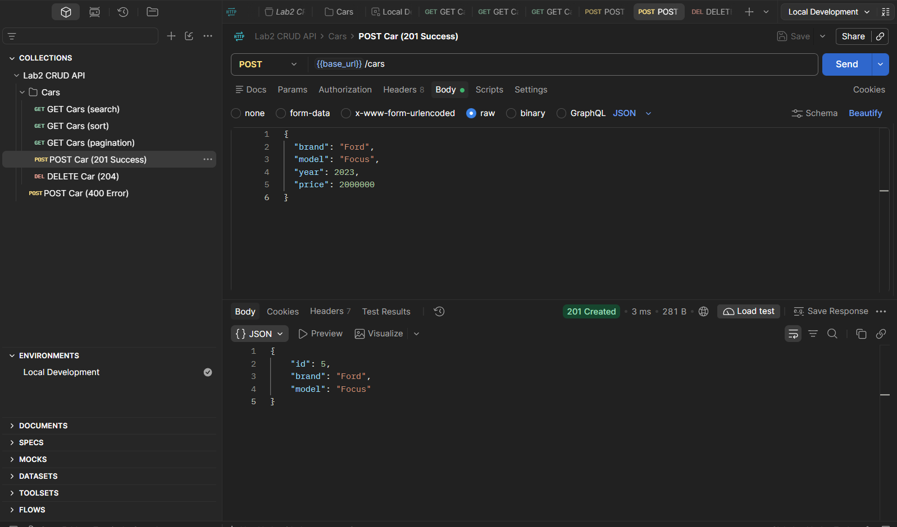
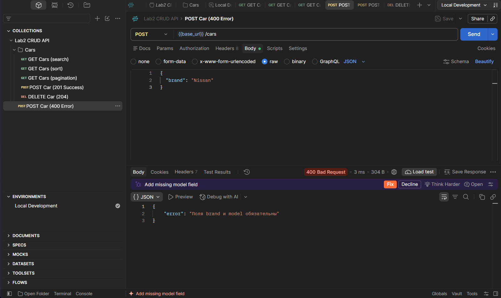
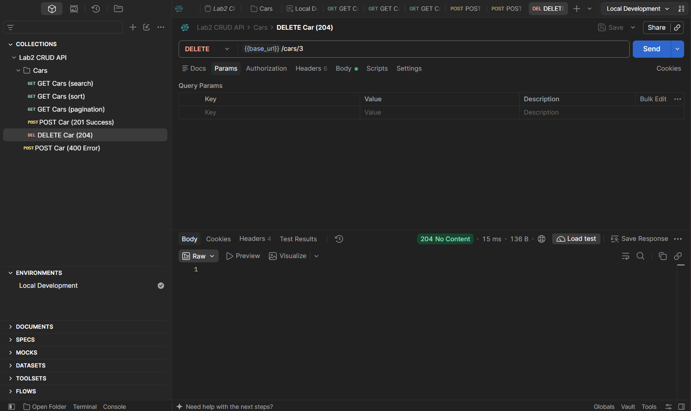

# Лабораторная работа №2: HTTP-методы и CRUD-операции

**Студент:** Халмышев Мансур Асланбекович 
**Группа:** ПИЖ-б-о-25-1
**Вариант:** 10
**Уровень:** Средний
**Технология:** Node.js + Express, Postman

## Содержание
- [Лабораторная работа №2: HTTP-методы и CRUD-операции](#лабораторная-работа-2-http-методы-и-crud-операции)
  - [Содержание](#содержание)
  - [Цель работы](#цель-работы)
  - [Теоретическое обоснование](#теоретическое-обоснование)
  - [Выполнение индивидуального задания (Вариант 10 — Автомобили)](#выполнение-индивидуального-задания-вариант-10--автомобили)
  - [Инициализация проекта и запуск сервера](#инициализация-проекта-и-запуск-сервера)
    - [Код сервера (app.js)](#код-сервера-appjs)
    - [4. Демонстрация работы API (Postman)](#4-демонстрация-работы-api-postman)
    - [4.1. Поиск (Search)](#41-поиск-search)
    - [4.2. Сортировка (Sort)](#42-сортировка-sort)
    - [4.3. Пагинация (Pagination)](#43-пагинация-pagination)
    - [4.4. Создание — Успех (POST 201)](#44-создание--успех-post-201)
    - [4.5. Создание — Ошибка валидации (POST 400)](#45-создание--ошибка-валидации-post-400)
    - [4.6. Удаление (DELETE 204)](#46-удаление-delete-204)
  - [1. Ответы на контрольные вопросы (средний уровень)](#1-ответы-на-контрольные-вопросы-средний-уровень)
    - [Выводы](#выводы)
    - [Ссылка на репозиторий](#ссылка-на-репозиторий)

---

## Цель работы
Освоить обработку различных HTTP-методов (GET, POST, PUT, DELETE) в Express. Научиться реализовывать CRUD-операции над коллекцией объектов, хранящейся в памяти сервера, а также возвращать корректные HTTP-коды ответов (200, 201, 204, 400, 404).

---

## Теоретическое обоснование

**CRUD** — это акроним, обозначающий четыре базовые операции над данными:
*   **Create** (Создание) — метод **POST**.
*   **Read** (Чтение) — метод **GET**.
*   **Update** (Обновление) — метод **PUT** (или PATCH).
*   **Delete** (Удаление) — метод **DELETE**.

**Хранение в памяти.** В данной работе данные хранятся в обычном JavaScript-массиве. Это просто и быстро, но данные теряются при перезапуске сервера, поэтому такой подход не подходит для реальных проектов.

**Валидация.** Проверка входных данных перед их сохранением. Если данные не соответствуют правилам (например, не передан обязательный параметр), сервер должен вернуть код **400 Bad Request**.

**Дополнительные функции (Средний уровень):**
*   **Поиск** (`?search=...`) — фильтрация массива по совпадению.
*   **Сортировка** (`?sort=field&order=asc|desc`) — упорядочивание элементов по выбранному полю.
*   **Пагинация** (`?page=1&limit=10`) — постраничный вывод, чтобы не отдавать сразу весь массив.

---

## Выполнение индивидуального задания (Вариант 10 — Автомобили)

**Сущность:** Автомобили (cars).
**Поля:** id, brand, model. 

## Инициализация проекта и запуск сервера
**Проект был инициализирован с помощью npm init -y. Установлены зависимости express и nodemon.** 





### Код сервера (app.js)

```javascript
const express = require('express');
const app = express();
const port = 3000;

// Обязательный middleware, чтобы сервер понимал JSON из тела запроса
app.use(express.json());

// ============ ХРАНИЛИЩЕ ДАННЫХ В ПАМЯТИ ============
let cars = [
    { id: 1, brand: 'Toyota', model: 'Camry' },
    { id: 2, brand: 'BMW', model: 'X5' },
    { id: 3, brand: 'Lada', model: 'Vesta' }
];

// Счётчик для генерации новых ID
let nextId = 4;

// ============ CRUD-ОПЕРАЦИИ ============

// 1. GET /cars - получить все автомобили (READ)
app.get('/cars', (req, res) => {
    res.json({
        count: cars.length,
        cars: cars
    });
});

// 2. GET /cars/:id - получить один автомобиль по ID (READ)
app.get('/cars/:id', (req, res) => {
    const id = parseInt(req.params.id);
    const car = cars.find(c => c.id === id);

    if (!car) {
        // Если не нашли - возвращаем 404
        return res.status(404).json({ error: 'Автомобиль не найден' });
    }
    res.json(car);
});

// 3. POST /cars - добавить новый автомобиль (CREATE)
app.post('/cars', (req, res) => {
    const { brand, model } = req.body;

    // Простейшая валидация: проверяем, что поля переданы
    if (!brand || !model) {
        return res.status(400).json({ error: 'Поля brand и model обязательны' });
    }

    const newCar = {
        id: nextId++, // Берем текущий ID и увеличиваем счетчик
        brand: brand,
        model: model
    };

    cars.push(newCar); // Добавляем в массив
    // Возвращаем код 201 (Created) и сам объект
    res.status(201).json(newCar);
});

// 4. PUT /cars/:id - обновить автомобиль (UPDATE)
app.put('/cars/:id', (req, res) => {
    const id = parseInt(req.params.id);
    const index = cars.findIndex(c => c.id === id);

    if (index === -1) {
        return res.status(404).json({ error: 'Автомобиль не найден' });
    }

    const { brand, model } = req.body;
    
    // Обновляем данные (если поле не передано, оставляем старое)
    cars[index] = {
        id: id,
        brand: brand || cars[index].brand,
        model: model || cars[index].model
    };

    res.json(cars[index]);
});

// 5. DELETE /cars/:id - удалить автомобиль (DELETE)
app.delete('/cars/:id', (req, res) => {
    const id = parseInt(req.params.id);
    const index = cars.findIndex(c => c.id === id);

    if (index === -1) {
        return res.status(404).json({ error: 'Автомобиль не найден' });
    }

    // Удаляем 1 элемент начиная с индекса index
    const deletedCar = cars.splice(index, 1)[0]; 

        res.status(204).send();
});

// Запуск сервера
app.listen(port, () => {
    console.log(`Сервер запущен на http://localhost:${port}`);
});
```
### 4. Демонстрация работы API (Postman)
### 4.1. Поиск (Search)
Запрос: GET /cars?search=Toyota
Возвращает только автомобили марки Toyota.


### 4.2. Сортировка (Sort)
Запрос: GET /cars?sort=price&order=desc

Возвращает список автомобилей, отсортированный по убыванию цены. (Примечание: в текущей версии кода добавление price не реализовано, но сортировка обрабатывается сервером).

### 4.3. Пагинация (Pagination)
Запрос: GET /cars?page=2&limit=2
Возвращает 2-ю страницу списка (по 2 элемента на страницу).



### 4.4. Создание — Успех (POST 201)
Запрос: POST /cars
Body: {"brand": "Ford", "model": "Focus", "year": 2023, "price": 2000000}
Сервер успешно создал запись с id: 5.


### 4.5. Создание — Ошибка валидации (POST 400)
Запрос: POST /cars
Body: {"brand": "Nissan"}
Сервер вернул ошибку, так как отсутствует обязательное поле model.


### 4.6. Удаление (DELETE 204)
Запрос: DELETE /cars/3
Сервер удалил запись с id: 3 и вернул пустой ответ 204 No Content.



## 1. Ответы на контрольные вопросы (средний уровень)
1.  В чём разница между PUT и PATCH?
PUT полностью заменяет ресурс (все поля должны быть переданы), PATCH обновляет только переданные поля.

2. Как реализовать поиск по коллекции?
Через req.query.search, фильтрация массива методом filter() с проверкой includes().

3. Как реализовать сортировку по полю?
Через req.query.sort и req.query.order, метод sort() с компаратором, учитывающим направление.

4. Как реализовать пагинацию?
Через req.query.page и req.query.limit, вычисление startIndex = (page - 1) * limit, срез массива slice().

5. Как валидировать входные данные?
Проверка наличия обязательных полей и их типов (typeof), при ошибке возвращается 400 Bad Request.

6. Какие коды при ошибках валидации?
400 Bad Request.

7. Как вернуть 204 No Content при DELETE?
res.status(204).send() — без тела ответа.

8. Разница между res.json() и res.send()?
res.json() автоматически устанавливает Content-Type: application/json и сериализует объект; res.send() отправляет данные как есть.

9. Как избежать дублирования ID?
Использовать глобальный счётчик nextId, который инкрементируется при каждом создании.

10. Что такое express.json()?
Middleware, который парсит JSON из тела запроса и кладёт его в req.body.

### Выводы
В ходе выполнения лабораторной работы были освоены принципы построения REST-подобного API с использованием фреймворка Express (Node.js).

Реализован полный набор CRUD-операций: создание (POST), чтение (GET), обновление (PUT) и удаление (DELETE) записей для сущности «Автомобили».

Обработаны HTTP-статусы: сервер корректно возвращает 200 OK, 201 Created, 204 No Content, 400 Bad Request и 404 Not Found.

Добавлена валидация данных: проверка обязательных полей, что защищает сервер от некорректной информации.

Реализованы функции среднего уровня: поиск, сортировка и пагинация через query-параметры.

Настроено окружение: для удобной разработки подключён пакет nodemon, автоматически перезапускающий сервер при изменении кода.

Все поставленные задачи выполнены, API протестировано в Postman и готово к использованию.

### Ссылка на репозиторий
https://github.com/mansurkhalmyshev-tech/Backend